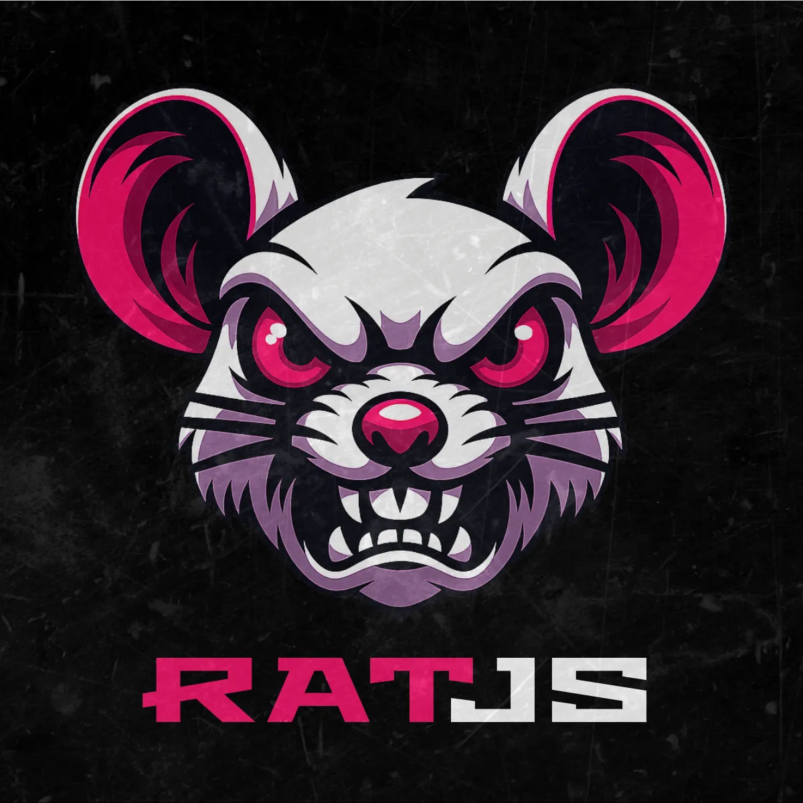

# rat

---

## docs & demos
- [compiler v0](.md/compiler.md)
- [concept](.md/concept.md)
- [syntax v0](.md/syntax.md)

## demos
- [demos](demos/)
- [playground](demos/playground/)

## packages

| package         | path                                     | status |
|-----------------|------------------------------------------|--------|
| `@rat/compiler` | [`packages/compiler`](packages/compiler) | v0     |
| `@rat/runtime`  | [`packages/runtime`](packages/runtime)   | v0     |
| `@rat/syntax`   | [`packages/syntax`](packages/syntax)     | v0: hljs, monaco, codemirror/acode, zed, textmate |
| `@rat/core`     | [`packages/core`](packages/core)         | skizze |
| `@rat/types`    | [`packages/types`](packages/types)       | skizze |

---

···
